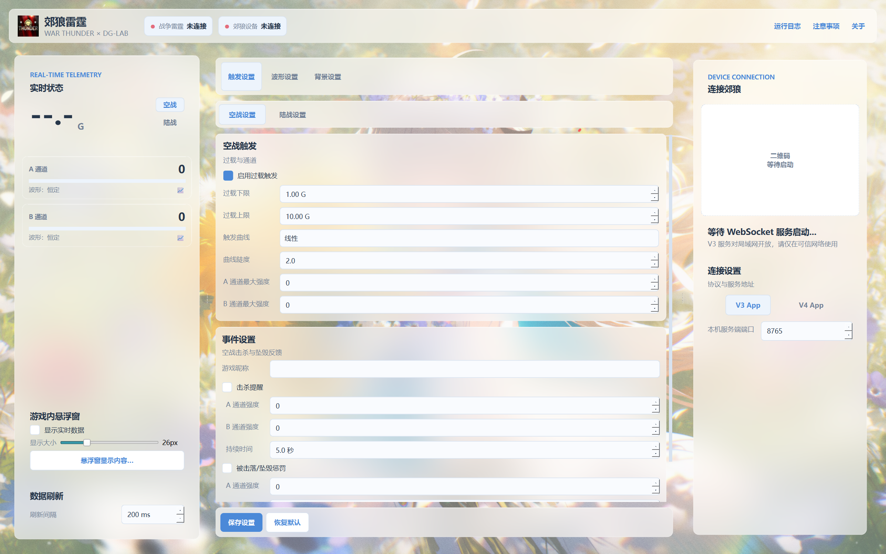

<p align="center">
  
</p>

<h1 align="center">郊狼雷霆 · WT-DGLAB</h1>

<p align="center">
  将《战争雷霆》的过载、速度与战斗事件，转化为 DG-LAB 郊狼 3.0 的双通道反馈。
</p>

<p align="center">
  <strong>v1.1.5</strong> · Windows 10 / 11 · DG-LAB App V3 / V4
</p>

<p align="center">
  <a href="https://github.com/Unscientificcat/WT-DGLAB/releases">下载发布版</a> ·
  <a href="#快速开始">快速开始</a> ·
  <a href="#常见问题">常见问题</a> ·
  <a href="RELEASE_NOTES.md">更新公告</a> ·
  <a href="https://github.com/Unscientificcat/WT-DGLAB/issues">反馈问题</a>
</p>

郊狼雷霆是一款 Windows 桌面工具，通过《战争雷霆》本机的 `8111` 接口读取游戏数据，按你的设置控制郊狼 A/B 通道的强度与波形。支持空战、陆战和陆战空中支援（CAS），也可以在未连接设备时查看游戏事件预览。

> [!WARNING]
> 本项目会控制电刺激设备。使用前请完整阅读[《注意事项》](resources/注意事项.txt)，从 `0` 强度开始设置与测试。未成年人、孕妇、心脏疾病患者及植入医疗设备者请勿使用。

## 界面预览



*当前版本的默认界面，尚未连接游戏或设备；截图未启用游戏采集与设备服务。左侧查看实时状态，中间调整触发与波形，右侧连接手机 App。*

## 能做什么

| 功能 | 使用方式 |
| --- | --- |
| 空战过载反馈 | 根据法向过载 G 值映射强度，自行设置过载上下限与 A/B 通道最大强度。 |
| 陆战速度反馈 | 根据载具速度映射强度，速度上下限与双通道参数独立配置。 |
| CAS 空中支援 | 陆战中进入飞机时切换到 CAS 过载配置；CAS 可独立开关，击杀与坠毁事件沿用陆战事件设置。 |
| 战斗事件 | 为击杀、被击落、坠毁、被摧毁等事件设置强度、持续时间与波形。 |
| 部件损伤反馈 | 识别坦克部件或乘员损伤变化，触发短时反馈，可设置冷却时间。 |
| 维修反馈 | 游戏接口提供维修状态时，在维修期间使用指定强度与波形。 |
| 静止惩罚 | 陆战中持续低于设定速度、超过设定时间后触发，恢复移动后停止。 |
| 触发曲线 | 空战、陆战与 CAS 分别支持线性、指数、对数曲线；非线性曲线可调整陡度。 |
| 自定义波形 | 支持官方明文 `.pulse` 文件、双通道独立选波和随机切换。 |
| 实时显示 | 仪表盘与置顶悬浮窗显示遥测、事件、双通道强度与波形名；点击通道卡查看输出强度曲线。 |

此外，还支持自定义背景、卡片透明度、配置保存、运行日志、系统托盘和单实例启动。悬浮窗内容可逐项开关，主字号可在 **13–65 px** 之间调整。

### 事件与波形说明

- **填写游戏昵称**：在对应模式的事件设置中填写与游戏内一致的昵称，程序据此判断击杀方和被击杀方。HUD 事件支持简体中文、繁体中文、英语、俄语、法语、德语和日语自动识别。
- **部件损伤不等于每次受击**：功能依赖游戏提供的部件或乘员损伤字段，无法保证识别每一次普通命中。维修同样依赖实际接口字段，缺失时不会推测维修状态。
- **事件有优先级**：死亡／被摧毁 > 击杀 > 维修 > 部件损伤 > 静止惩罚 > 常规过载／速度映射，不叠加强度；事件结束后恢复当前有效的常规输出。
- **未连接也可预览**：主界面与悬浮窗可显示已识别的事件，中途连接或重连设备不会补发此前的事件。
- **内置恒定波形**固定为 10 Hz、100% 波形幅度，输出大小由通道强度和 App 限制决定；自定义波形保留原始幅度曲线。

## 使用前准备

| 项目 | 要求 |
| --- | --- |
| 电脑 | 64 位 Windows 10 / 11 |
| 游戏 | Windows 版《战争雷霆》，本机可访问 `127.0.0.1:8111` |
| 设备 | DG-LAB 郊狼 3.0 及配套线材、贴片 |
| 手机 | 安装 DG-LAB 3.x 或 4.x App |
| V3 连接 | 手机与电脑处于可互通的同一局域网 |
| V4 连接 | 手机和电脑均可访问所用的 WebSocket Relay |

发布版自带运行依赖，**无需安装 Python**。

## 快速开始

### 1. 下载并完整解压

前往 [GitHub Releases](https://github.com/Unscientificcat/WT-DGLAB/releases)，下载所需版本的程序 ZIP 压缩包。普通用户请选择发布页的程序附件，GitHub 自动生成的 **Source code** 是源码包。

将程序包完整解压到可写目录，运行其中的 `WT-DGLAB.exe`。程序采用目录打包，请勿只复制 EXE，也不要直接在压缩包内运行。

```text
WT-DGLAB v版本号/
├── WT-DGLAB.exe
├── _internal/           # 程序运行依赖
├── resources/           # 图标、默认背景和注意事项
├── config.default.json  # 默认配置模板
├── README.md
└── LICENSE
```

`_internal/` 和 `resources/` 必须保持与 EXE 的相对位置。首次运行后会生成用户配置，波形和自定义背景目录按需自动创建。

### 2. 连接手机 App

在程序右侧选择与你手机 App 对应的协议。

**DG-LAB 3.x App（V3）**

1. 手机和电脑连接同一局域网，避免访客 Wi-Fi 或 AP 隔离。
2. 选择 **V3 App**，默认本机服务端端口为 `8765`。
3. 首次使用时允许程序通过 Windows 防火墙的“专用网络”。
4. 在手机 App 的 Socket 控制／扫码入口扫描程序二维码。

V3 不需要路由器公网端口映射，请仅在可信局域网内使用。若修改端口，防火墙规则也需允许相应 TCP 端口。

**DG-LAB 4.x App（V4）**

1. 选择 **V4 App**，程序自动连接 Relay。
2. 默认地址为 `wss://trex.dungeon-lab.cn/v4`，也支持自建的 `ws://` 或 `wss://` Relay。
3. 等待二维码出现，在手机 App 的 Socket 控制入口扫码。
4. 只有一个可用设备时自动选择；出现多个候选时，请手动选择要控制的设备。

V4 由电脑主动连接 Relay，通常不需要开放电脑的 `8765` 入站端口。连接成功后，右侧状态区仅显示“已连接”，二维码自动收起；诊断详情可在运行日志中查看。

### 3. 设置游戏反馈

1. 阅读并确认程序首次启动的注意事项，保持各项强度为 `0`。
2. 启动《战争雷霆》，进入试驾或有效对局。
3. 在左侧选择空战或陆战模式，在中间设置对应的过载／速度范围、触发曲线和双通道参数。
4. 如需击杀、死亡等事件反馈，填写游戏昵称，开启所需事件，并分别设置其强度、持续时间和波形。
5. 点击“保存设置”，确认游戏识别、模式和波形正确后，再逐步调整强度。

常规映射的“通道最大强度”和事件的“通道强度”是不同参数，请分别检查；手机 App 的强度上限与静音设置也会影响设备输出。

关闭窗口右上角的 **×** 会隐藏到系统托盘，后台继续运行。双击托盘图标恢复窗口；需要结束程序时，右键托盘图标选择 **退出程序**。

## 自定义波形与升级迁移

### 添加波形

将 DG-LAB 官方明文 `.pulse` 文件放入程序同级的 `waveforms/` 目录，在中间的 **波形设置** 页刷新并选择。

- A/B 通道可以选择不同波形。
- 常规输出可设置随机切换时间范围，事件可在触发时随机选取波形。
- 没有有效自定义波形时使用内置“恒定”；无法解析的文件会提示并跳过。
- 仓库和发布包不附带个人波形，需要自行添加。

### 从旧版升级

新版目录不会自动读取旧目录配置。退出旧程序后，将新版解压到独立目录，按需迁移：

| 文件／目录 | 内容 |
| --- | --- |
| `config.json` | 玩家昵称、强度、触发、连接与界面设置 |
| `waveforms/` | 自行添加的 `.pulse` 波形 |
| `backgrounds/` | 自定义背景图片 |

请先备份旧文件，再复制到新版对应位置；不要用旧版 `_internal/` 或 `resources/` 覆盖新版。迁移配置会带入旧强度，首次运行请重新检查各模式与事件参数。

## 常见问题

**游戏显示未连接，或进入机库后没有输出？**

先在同一台电脑的浏览器打开 `http://127.0.0.1:8111/state`。无法访问时，确认游戏已启动，再检查本机网络或安全软件。接口可访问与处于有效对局是两回事：机库、主菜单或 `valid=false` 时没有输出属于正常行为。程序读取游戏接口时会绕过系统代理。

**V3 扫码后连接不上？**

检查电脑与手机是否在同一可互通网段、二维码对应的是否为可访问的局域网 IP，以及 Windows 专用网络防火墙是否放行程序和设置的端口。访客网络、无线隔离和虚拟网卡可能影响连接。

**V4 一直在连接 Relay？**

确认电脑和手机都能访问填写的 Relay 地址。可以切换协议后重试；官方 Relay 不可用时，可参考[官方服务端项目](https://github.com/dungeonlab-open/dglab-websocket-server)部署自己的 Relay。

**已经连接，为什么没有输出？**

依次检查：是否处于有效对局、模式与触发开关是否正确、数值是否达到阈值、对应通道或事件强度是否仍为 `0`。同时检查手机 App 的设备连接、通道上限与静音状态。仅看见事件预览，不代表该事件获得了设备输出资格。

**为什么退出对局后数值清空？**

游戏可能保留上一局的部分遥测。程序在离开有效对局后清空状态并停止相关输出，避免继续使用残留速度或过载数据。

**如何反馈问题？**

点击顶部 **运行日志 → 导出本次日志**，文件保存在程序旁的 `logs/` 目录。请在退出前导出，再到 [Issues](https://github.com/Unscientificcat/WT-DGLAB/issues) 说明程序版本、App 版本、复现步骤并附上日志；分享前请检查并遮盖个人信息。

正常退出且清理成功时，本次自动日志会删除；手动导出的日志会保留。关闭到托盘不会停止记录，也不会删除本次日志。

## 从源码运行

需要 Python 3.11 或更高版本；当前开发与打包使用 Python 3.14。以下命令在 Windows PowerShell 中执行：

```powershell
git clone https://github.com/Unscientificcat/WT-DGLAB.git
cd WT-DGLAB
py -3.14 -m venv .venv
.\.venv\Scripts\python.exe -m pip install --upgrade pip
.\.venv\Scripts\python.exe -m pip install -r requirements.txt
.\.venv\Scripts\python.exe main.py
```

如果使用其他兼容的 Python 版本，请将创建虚拟环境命令中的 `-3.14` 改为已安装的版本。源码运行时，配置、个人波形和背景保存在项目根目录对应位置。

运行自动化测试：

```powershell
.\.venv\Scripts\python.exe -m pip install pytest pytest-asyncio
.\.venv\Scripts\python.exe -m pytest -q
```

生成 Windows 目录包和 ZIP：

```powershell
.\.venv\Scripts\python.exe -m pip install pyinstaller
.\.venv\Scripts\python.exe build.py
```

产物位于 `dist/WT-DGLAB v版本号/` 及同名 ZIP。构建时使用默认配置模板，不打包本机个人配置、日志或自定义波形。

### 进一步了解

- [版本更新公告](RELEASE_NOTES.md)
- [功能需求](docs/requirements.md) · [技术规格](docs/tech-spec.md) · [界面设计](docs/design-spec.md)
- [触发与输出机制](docs/trigger-output-refactor.md) · [V4 App 接入说明](docs/v4-app-adaptation.md)
- [开发计划](docs/dev-plan.md) · [开发日志](devlog/)
- [战争雷霆 8111 接口社区资料](https://github.com/lucasvmx/WarThunder-localhost-documentation)
- [DG-LAB 郊狼 3.0 蓝牙协议](https://github.com/dungeonlab-open/dglab-bluetooth-protocol/blob/main/coyote/v3/README.md)

## 作者与许可

作者：**某不科学的猫酱** · [B 站主页](https://space.bilibili.com/247197404) · [GitHub 仓库](https://github.com/Unscientificcat/WT-DGLAB)

本项目采用 [MIT License](LICENSE) 开源。使用、修改和再发布时，请保留许可证及版权声明。

本项目为非官方第三方工具，与 Gaijin Entertainment、War Thunder、DG-LAB 或地牢实验室不存在隶属或授权关系。相关名称与商标归各自权利人所有。
