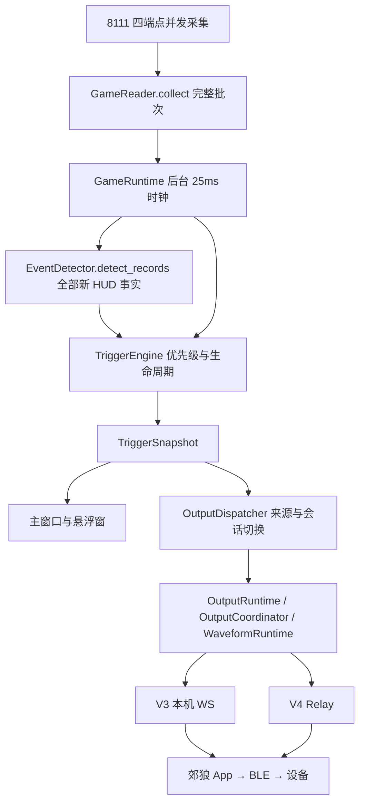

# 触发与郊狼输出重构（2026-10-31）

本轮交付根目录源码，保留 V3 本机服务与 V4 Relay，面向郊狼 3.0。旧 EXE 不包含本轮修改，版本号暂不递增。自动验证和实机验收分开记录。

## 问题与调整

原链路把遥测、HUD、事件期限、维修恢复、静止惩罚和输出提交分散在 GUI 定时器及多条队列中。同批事件只返回一个结果，维修可能被 HUD 覆盖；对局接口短暂失败时，已消费的 HUD 变化没有后续确认入口。V3/V4 分别生成和缩放波形，通道强度又乘一次幅度百分比，使恒定输出低于当前强度对应的满幅。

现在四个 8111 端点并发采集成批次，事件识别返回全部事实，由单一后台状态机仲裁。GUI 读取结果并显示，协议适配器共用输出协调和波形层。



## 模块边界

| 模块 | 职责与入口 |
| --- | --- |
| `src/game_reader.py` | `collect()` 并发请求 `/state`、`/indicators`、`/map_info.json`、完整 `/hudmsg`；返回端点时间、成功状态和遥测；`close()` 释放采集线程与会话 |
| `src/event_detector.py` | `detect_records()` 无网络解析；每个 ID 比较最近的时间和规范化消息，返回 `tuple[GameEvent, ...]`；旧 `poll()` 仅供兼容调用 |
| `src/trigger_models.py` | 固定事件身份、首次观察时间、配置场景、输出资格、播放期限和界面结果 |
| `src/trigger_engine.py` | `observe()` 消费全部事实和遥测；`tick()` 独立处理到期、状态恢复并生成完整双通道意图；不依赖 Qt 或网络 |
| `src/game_runtime.py` | 一条业务线程；另一个有界执行器执行采集批次。`configure()` 复制配置，`snapshot()` 发布结果，`advance()` 执行时钟和非阻塞输出提交 |
| `src/connection_service.py` | 后台串行管理适配器启动、替换、重试与退出 |
| `src/output_runtime.py` | 输出邮箱、会话和通道代次、1 秒租约、25ms 看门狗、连接快照 |
| `src/output_coordinator.py` | V3/V4 共用停止、波形配置、双通道强度协调、网络等待后重验资格和有限故障重试 |
| `src/waveform_runtime.py` | 共用恒定帧、自定义原始帧读取、随机换波 |
| V3/V4 控制器 | 协议编码、握手、上报、停止确认和补给节奏；不计算游戏事件 |
| `main.py` | 创建服务、发布配置、渲染后台结果、管理窗口与退出 |

采集快照交付后台后不再修改。GUI 仅读取发布结果；不把可变配置对象直接共享给业务线程。外部集成应使用 `collect()`、`detect_records()` 和完整 `OutputIntent`，旧单值调用不作为当前业务链路。

## 触发规则

1. **死亡 > 击杀 > 维修 > 部件损伤 > 静止惩罚 > 常规映射**。同批按优先级处理，低级瞬时事件不排队。同类新事实重新计时，不叠加强度。
2. 有限事件截止时间为首次识别时间加配置时长。采集等待、GUI 卡顿和网络发送不延长期限。维修由当前有效遥测维持，结束即撤销；击杀结束可恢复仍有效的维修，死亡取消旧维修。
3. HUD 首次成功读取只建立基线。ID 允许为 0；同 ID 时间或文本发生变化可重新识别，不要求跨局单调递增。超时或空列表不清空指纹，相同历史不重复触发。
4. 文本先规范 Unicode、零宽字符、空白和大小写；区分主动、被动及坠毁模板。匹配昵称边界并剔除末尾载具括号，避免较长昵称或载具名冒充玩家。昵称仍须准确配置，不保证未知本地化模板全部可识别。
5. 飞机过载、坦克速度、CAS 沿用原映射。陆战模式上飞机使用陆战事件参数及飞机死亡语义，CAS 关闭同时抑制飞机事件。临时丢失载具类型时使用最近上下文解析待确认 HUD。
6. 明确 `valid:false` 表示退出对局，清除事件和地面状态。HTTP 失败或无法确认地图表示未知，立即停止设备输出；近期有效对局中的 HUD 最多保留 1 秒等待确认，恢复时沿用原始期限和设备资格。HTTP 失败、遥测无效和断开均不推断死亡。
7. 坦克乘员明确从存活变为全灭可补充死亡证据，缺失、负数及非有限数值保持未知。HUD 确认的自身坠毁属于死亡。死亡后忽略损伤和静止惩罚，须在连续有效遥测中确认至少 1 秒移动才解除封锁；此判断独立于静止惩罚开关。
8. 部件损伤在有效连续批次间差分，首次为基线，同帧多部件只生成一次；冷却中的变化被消费，结束后不补播。维修、无效数据、离开地面或移动重置静止计时。超过 1 秒的采集空档不计作持续静止或持续移动。
9. 未连接时仍预览事件。资格固定在采集请求开始时的控制器、会话和绑定状态；连接、重连、设备或协议切换不会授权旧事件。切换先撤销旧输出，旧事件到期后才恢复最新常规映射。

维修只在接口实际给出 `is_repairing` 时识别，缺失时诊断为“维修状态：当前接口未提供”。现有真实试驾记录没有该字段，不能将模拟维修测试视为实机能力已证实。普通命中也不能由 8111 保证完整提供；当前“被命中”仍指部件/乘员损伤边沿。

## 波形与协议

| 项目 | 当前规则 |
| --- | --- |
| 恒定 | 固定 10 Hz，四个采样幅度均 100%；强度 30 对应通道 30 下的满幅，不再乘 `30/200` |
| 自定义 | 保留 `.pulse` 解析后的频率、幅度、休止帧；不额外乘通道强度 |
| 曲线 | `通道强度 × 幅度百分比 / 100`，标注为估算；不声称实测电压 |
| V3 | 绝对设置强度，归零并清空队列；预充 2 秒，此后每秒补 1 秒 |
| V4 | 非零目标使用 `t:3` 相对操作；`t:7` 只归零。停止顺序为清任务、绝对归零，均保留确认处理；每 500ms 替换 1 秒波形 |
| 上限与手动调整 | 程序维持当前目标，受 App 上限与静音约束；响应未知先归零重建基准，避免盲目累加 |

波形配置变化从首帧开始；新事件经过停止屏障重置播放位置；常规同波形连续更新不额外按强度改变曲线。双通道共用协调步骤，不宣称硬件物理同时执行。V3 发送完成不能等同设备确认，V4 RPC 完成也不是电极实测。

资料依据：

- [DG-LAB 官方 V4 协议](https://github.com/dungeonlab-open/dglab-kit#v4-protocol-reference)
- [DG-LAB 官方 WebSocket 协议](https://github.com/dungeonlab-open/dglab-websocket-simple/blob/main/socket/v2/README.md)
- [DG-LAB 官方郊狼 3.0 蓝牙协议](https://github.com/dungeonlab-open/dglab-bluetooth-protocol/blob/main/coyote/v3/README.md)
- [8111 HUD 接口社区文档](https://github.com/lucasvmx/WarThunder-localhost-documentation/blob/master/Hudmsg/Hudmsg.md)

本地 APK manifest 读取结果为版本 **4.2.6**、包名 `com.bjsm.dungeonlabs4`。本轮仅检查 ZIP、manifest 和 DEX 字符串，未完整反编译；实现以官方协议与现有响应测试为依据，不宣称已证实 APK 内部全部行为。

## 验证与复测

自动结果见 `devlog/2026-10-31.md` 和 `build/refactor-tests.txt`。保留协议故障、停止屏障、超时、上限、静音和会话测试；原先调用已删除 GUI 私有方法的测试迁移到生产状态机及协议链路，测试总数不能直接与旧架构比较。

已使用匿名真实 HUD 样本核验 ID 复用、新增记录和去重；完整窗口使用隔离配置、空波形目录检查离线预览、悬浮窗一致、到期和退出。没有连接真实手机或设备。

在项目根目录启动：

```powershell
py -3.14 main.py
```

开发机完整测试：

```powershell
$env:PYTHONDONTWRITEBYTECODE='1'
$env:QT_QPA_PLATFORM='offscreen'
py -3.14 -B -m pytest -q
```

下一步实机验收顺序：

1. 从根目录源码启动，核对日志中的解释器与入口路径。先不连接设备，设置准确昵称，验证新击杀、自身死亡/坠毁以及连续事件；重复进出试驾，确认首杀不被吞。
2. V3、V4 分别扫码，检查初始化归零；用当前允许的强度核对恒定满幅和自定义原曲线。App 中降低上限、手动改强度、静音后再恢复，检查目标与限制。
3. A/B 分别验证事件后恢复 0 与非零常态；事件中断开/重连不补播，事件中切换模式或退出不残留波形。
4. 空战、陆战及 CAS 分别核对识别文本和配置来源。维修只有实际字段出现后才验收；无字段时保留不可用诊断，不伪造触发。
5. 若有漏触发，用 `py -3.14 tools/record_8111.py --duration 120` 采集新现场，同时保留程序日志，以事件 ID、端点状态和仲裁原因定位。

本地基线位于 `backup/refactor-baseline-20261031/`，不含个人波形内容；个人配置和波形仅做摘要校验。本轮不修改旧发布目录、不打包或发布。
